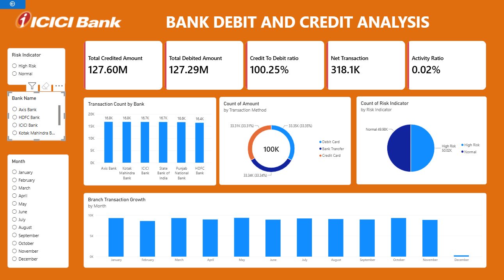
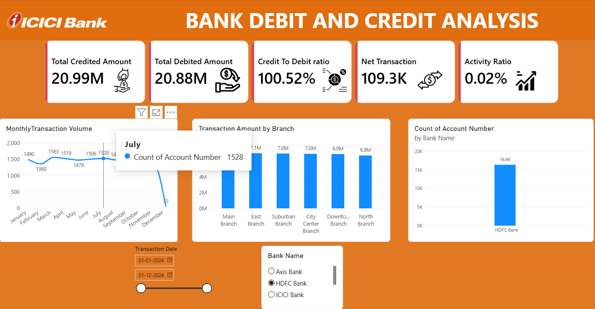

# Bank Debit and Credit Analysis | Power BI
## Project Overview
This project analyzes banking transaction data using Microsoft Power BI. The dashboard provides insights into debit and credit transactions, transaction methods, bank-wise activity, risk indicators, and monthly transaction trends.
## Dashboard Preview
### Dashboard Page 1

### Dashboard Page 2

## Key Performance Indicators (KPIs)
- Total Credited Amount
- Total Debited Amount
- Credit to Debit Ratio
- Net Transaction
- Activity Ratio
## Dashboard Insights
- Analyzed total credited and debited amounts.
- Compared transaction counts across different banks.
- Examined transaction distribution by payment method.
- Visualized high-risk and normal transaction indicators.
- Analyzed monthly transaction trends.
- Compared transaction activity across branches.
## Tools and Technologies
- Microsoft Power BI
- Power Query
- DAX
- Data Visualization
- Data Cleaning
## Project Files
- `Bank_Analysis.pbix` – Power BI dashboard file.
- `Bank_Transactions.csv` – Dataset used for analysis.
- `dashboard-page-1.png` – Dashboard screenshot 1.
- `dashboard-page-2.png` – Dashboard screenshot 2.
Author
Dhanush Anchan
Aspiring Data Analyst | Power BI | SQL | Excel | Tableau

**Dhanush Anchan**

Aspiring Data Analyst | Power BI | SQL | Excel | Tableau
